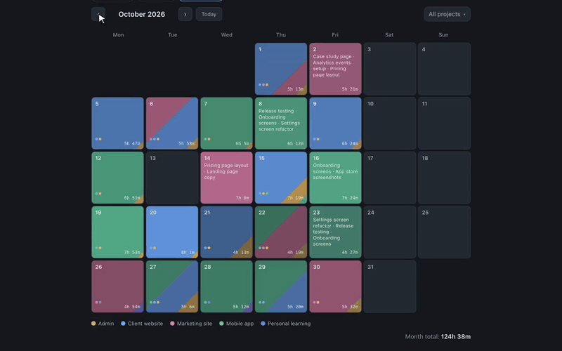

# Tick

A simple time tracker that's free, needs no sign-up, keeps your data in your own browser, and is open source.

**[▶ Live demo](https://yuragets.github.io/tick/)** — try it in your browser, no account needed.



<!-- Full demo video (media/demo.mp4): drag it into the GitHub editor here -->

## Why

I wanted to see where my working hours actually go, but most time trackers felt too heavy for that, or asked me to create an account before I could press "start". So I built a small one for myself: open it, start the timer, look at the calendar at the end of the month. Most of it was built together with Claude Code.

## Highlights

- **Calendar** — each day is colored by the projects you worked on; click a day to see every entry in it.
- **Timer** — start, pause, stop; it keeps running if you reload the page.
- **Reports** — today, week, month or a custom range, as a chart by project or by day.
- **Earnings calculator** — tracked hours × your hourly rate, with optional currency conversion.
- **Export and backup** — CSV for spreadsheets, PNG images of reports, and a JSON backup you can import back.

Also: projects with colors, tags, dark and light themes, English and Ukrainian.

## Your data

In the live demo everything is stored in your browser (`localStorage`) and never sent anywhere — there is no server. That also means clearing site data or switching browsers loses it, so use **Export backup** (in Settings) from time to time.

## Run locally

Requires Node.js 20+.

```bash
npm run setup   # install everything (once)
npm run dev     # start Tick
```

Then open http://localhost:5173. Locally, Tick saves your data to a file on your computer instead of the browser.

## For developers

**How it's built**

- **Frontend:** React 18, TypeScript, Vite 5, Zustand, Tailwind CSS, Recharts, Zod
- **Backend (local mode):** Express 4 + better-sqlite3, run with `tsx`; data lives in `server/data/tracker.db` (created on first run, ignored by git)
- **Hosting:** GitHub Pages, deployed by GitHub Actions on every push to `main`

**Two storage modes**

Storage sits behind a small `StorageAdapter` interface (`src/storage/`):

- `npm run dev` — `ApiAdapter`, talks to the local backend on port 3001 (SQLite).
- `npm run build:pages` — sets `VITE_STORAGE=local` and uses `LocalStorageAdapter`; this is the version on GitHub Pages. It also enables the welcome screen, demo data and the backup notice.

**Useful settings and scripts**

- `PORT` — backend port (default `3001`)
- `VITE_API_URL` — where the frontend looks for the backend (put it in `.env.local`)
- `npm run dev:web` / `npm run dev:server` — run only the frontend or only the backend
- `npm run build:pages && npm run preview:pages` — check the GitHub Pages build locally
- `npm run record:demo` — re-record the demo video, GIF and poster in `media/` (needs Google Chrome)
- `git config core.hooksPath .githooks` — enable the repo's git hooks after cloning

## Feedback

Found a bug or have an idea? [Open an issue](https://github.com/yuragets/tick/issues) — I read them all. And if Tick is useful to you, a star helps.

## License

[MIT](LICENSE) © 2026 Yurii
